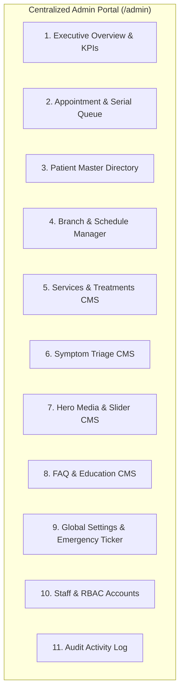

# Centralized Admin Dashboard Specification
## Sakib Dental Care — Back-Office Management Portal (`/admin`)

---

## 1. Overview & Vision
The **Sakib Dental Care Centralized Admin Dashboard** is the command center for clinic operations, patient serial queues, and web content. It empowers Dr. Sakib, practice administrators, and front-desk receptionists to manage the entire practice without touching a line of code or deploying git updates.

### 1.1 Secure & Discreet Access Entrypoints
The client website intentionally has zero public admin buttons, links, or visual cues. The clinic owner and authorized staff access the admin portal via:
1. **Desktop Key Shortcut:** Press `ESC` anywhere on the public landing page (auto-suppressed when typing in forms or when other modals are open).
2. **Mobile Secret Multi-Tap Gesture:** Tap the footer copyright text (`© 2026 Sakib Dental Care...`) or footer brand logo **5 times in rapid succession** (within 2.5 seconds).
3. Both entrypoints open the native, accessible Admin Sign-In modal dialog, which verifies credentials and navigates to `/dashboard`.

---

## 2. Layout, Aesthetics & User Experience
The dashboard adheres to the same premium **Apple glassmorphism design system** as the public portal while providing a high-density, professional administrative interface:
- **Left Navigation Sidebar:** Collapsible, categorized menu with real-time badges (e.g., active pending serial count `[5]`).
- **Top Header Utility Bar:**
  - Active Chamber indicator with live clock (e.g., `Nowhata: Open | City Branch: Opens 7 PM`).
  - Global omni-search (instantly finds patients by phone number, name, or serial ID).
  - Quick Action button: `+ New Walk-in Serial`.
  - Dark/Light mode toggle & User Profile / Logout menu.
- **Main Viewport:** High-speed data grids, search filters, tabbed views, and sliding side-drawers for record inspection.

---

## 3. Core Dashboard Modules & CRUD Workflows

### 3.1 Module 1: Executive Overview & Real-Time KPIs (`/admin`)
- **Key Metrics Ribbon:**
  - **Today's Total Serials:** Count of all visits scheduled for the current date.
  - **Nowhata Day Shift Queue:** Patients registered for Nowhata Bazar (9 AM – 6 PM).
  - **City Evening Shift Queue:** Patients registered for Sopura (7 PM – 11 PM).
  - **Pending Confirmations:** New web bookings awaiting receptionist phone/WhatsApp verification.
  - **Completed Treatments:** Procedures completed today.
- **Queue Progress Visualizer:** Real-time breakdown of patients currently in the waiting lounge vs. inside the dental operatory.
- **7-Day Trend Chart:** Daily booking volume graph across both branches.
- **Top In-Demand Treatments:** Bar chart showing top services (e.g., Root Canal, Ultrasonic Scaling, Dental X-Ray).

---

### 3.2 Module 2: Appointment & Serial Queue Management (`/admin/appointments`)
The core operational tool for receptionists and dentists.

#### View Modes:
1. **List / Table View:** Detailed data table with columns:
   - Serial ID (e.g., `SDC-20261105-001`)
   - Patient Name & Age
   - Contact Phone (with one-click "Call" and "Open WhatsApp" buttons)
   - Branch (Nowhata vs. Sopura City)
   - Requested Dental Service
   - Time Slot
   - Status Pill (`PENDING`, `CONFIRMED`, `IN_TREATMENT`, `COMPLETED`, `CANCELLED`, `NO_SHOW`)
   - Actions: `View Details`, `Update Status`, `Reschedule`, `Add Doctor Note`
2. **Kanban / Queue Pipeline View:**
   - Columns: `Pending Review` -> `Confirmed` -> `In Treatment` -> `Completed` -> `Cancelled / No Show`
   - Drag-and-drop or single-click status progression.

#### Key Operations:
- **Fast WhatsApp Ping:** Clicking the WhatsApp icon automatically formats a status message:
  *"Assalamu Alaikum [Name], your appointment at Sakib Dental Care (Nowhata Branch) for Root Canal Treatment on [Date] at [Slot] is CONFIRMED. Serial: SDC-20261105-001."*
- **Walk-in / Phone Serial Entry Modal:** Allows receptionists to enter a patient who calls by phone or walks into the chamber in under 15 seconds.
- **Doctor Notes & Prescription Drawer:** Dr. Sakib can open an appointment, view past visits, record diagnostic observations, specify prescribed medications, and schedule a 2nd-stage follow-up date (e.g., for crowns after RCT).
- **Export Roster:** One-click download of daily patient schedule to CSV or printable PDF.

---

### 3.3 Module 3: Patient Master Directory (`/admin/patients`)
- Consolidated record of every patient who has ever booked at Sakib Dental Care.
- Deduplication key: Mobile phone number (`01XXXXXXXXX`).
- Profile details: Full Name, Age, Gender, Primary Branch, Total Visits, Lifetime Completed Treatments, Medical Alerts (e.g., "Hypertensive", "Penicillin Allergy").
- Historical timeline: Chronological log of all procedures, dates, and doctor notes.

---

### 3.4 Module 4: Branch & Dynamic Schedule Manager (`/admin/branches`)
- **Branch Configuration:**
  - Edit Nowhata & City Branch names, addresses, hotline numbers, and Google Map links.
  - Toggle branch operating hours (Nowhata 9 AM – 6 PM; City Branch 7 PM – 11 PM).
- **Time Slot Customizer:**
  - Add, edit, or disable bookable time slots (e.g., add `6:30 PM` special slot or adjust morning intervals).
  - Configure maximum patient capacity per slot (default: 1 patient per slot).
- **Holiday & Emergency Calendar Overrides:**
  - Mark single-day or multi-day clinic closures (e.g., Eid holidays, National holidays, Chamber maintenance).
  - Set Ramadan custom hours (e.g., Nowhata 10 AM – 4 PM; City Branch 8 PM – 12 AM).
  - Toggling an override instantly updates the public booking date picker and status ticker.

---

### 3.5 Module 5: Dental Services & Treatments CMS (`/admin/services`)
- Centralized management of the 10+ core dental services.
- **CRUD Capabilities:**
  - **Create / Edit Service:**
    - Title (English & Bengali)
    - Category: `Diagnostic`, `Restorative`, `Cosmetic`, `Ortho-Surgical`
    - Short Summary (English & Bengali)
    - Estimated Procedure Duration (e.g., `45 – 60 Mins` / `৪৫ – ৬০ মিনিট`)
    - Equipment / Tech Tag (e.g., `Rotary Endomotor & Apex Locator`)
    - Aftercare Tips (English & Bengali)
    - Icon Selector (Phosphor icon library: `ph-tooth`, `ph-sparkle`, `ph-scan`, `ph-crown`, etc.)
    - Card Color Scheme (`sky`, `indigo`, `teal`, `rose`, `amber`, `emerald`)
    - Estimated Cost Range (Min BDT – Max BDT)
    - Active / Inactive switch
    - Reorder priority
- **Automatic Public Sync:** Modifying any service triggers `revalidateTag('services')`, refreshing the public cards and modal instantly.

---

### 3.6 Module 6: Symptom Guide Triage CMS (`/admin/symptoms`)
- Manage clinical symptoms displayed in the public interactive triage matcher:
  - Symptom Title (Bilingual)
  - Pathological Cause Explanation (Bilingual)
  - Primary Recommended Dental Service (Linked via foreign key to `DentalService`)
  - Secondary Diagnostic Service (e.g., Dental X-Ray)
  - Step-by-Step Clinical Procedure List (Bilingual JSON array)
  - Icon & Sort Order

---

### 3.7 Module 7: Hero Media & Showcase CMS (`/admin/hero-slides`)
- Manage the public landing page hero carousel:
  - Slide Type: `Video` or `Image`
  - Media Source: Uploaded image/video URL or remote CDN asset
  - Header Badge Text (English & Bengali)
  - Main Headline (English & Bengali)
  - Subtitle Description (English & Bengali)
  - Bottom Caption Text (English & Bengali)
  - Slide order & Active status toggle

---

### 3.8 Module 8: FAQs & Educational Content CMS (`/admin/faqs`)
- Manage patient-facing frequently asked questions:
  - Category (`Root Canal`, `Sterilization`, `Dental X-Ray`, `Appointments`)
  - Question & Detailed Answer (Bilingual HTML / Markdown support)
  - Reorder and toggle visibility

---

### 3.9 Module 9: Clinic Global Settings & Emergency Ticker (`/admin/settings`)
- Global key-value operational controls:
  - **Primary Hotline:** `01688-434676`
  - **WhatsApp Serial Number:** `01733-054717`
  - **Emergency Banner Active:** `true` / `false`
  - **Emergency Banner Message (EN/BN):** E.g., *"Special Ramadan Evening Schedule Active across Both Branches"*
  - **Footer Brand Notice:** Exzazon credits, copyright notice, and social links.

---

### 3.10 Module 10: Staff Accounts & Security (`/admin/users`)
- Restricted to `SUPER_ADMIN` and `CLINIC_ADMIN`.
- Create new user accounts for clinic doctors and receptionists.
- Assign roles (`SUPER_ADMIN`, `CLINIC_ADMIN`, `DOCTOR`, `RECEPTIONIST`).
- Force password resets and deactivate former employees.

---

### 3.11 Module 11: Audit Trail & Compliance (`/admin/audit-logs`)
- Read-only historical ledger:
  - Timestamp (UTC & Asia/Dhaka)
  - Staff User (Name & Email)
  - Action Category (`APPOINTMENT_CONFIRMED`, `SERVICE_EDITED`, `SCHEDULE_OVERRIDE`)
  - Target Entity ID
  - Changed Fields (before/after values)
  - Source IP Address

