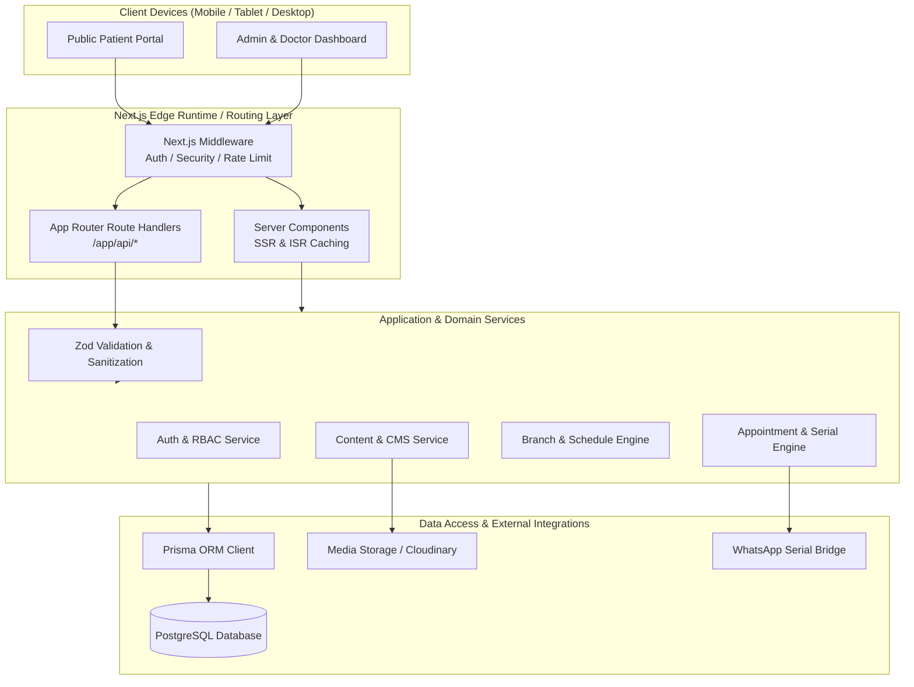
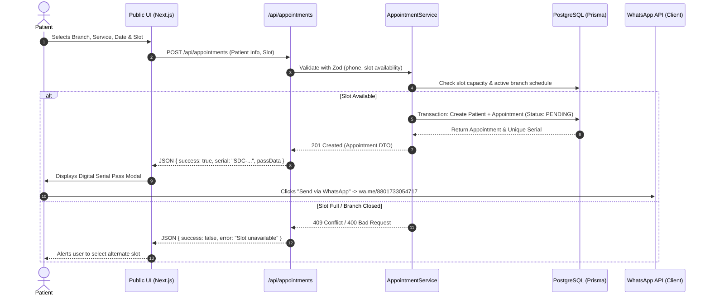

# Technical Architecture & System Design
## Sakib Dental Care — Full-Stack Next.js 15 Healthcare Platform

---

## 1. Architectural Principles & Overview

The Sakib Dental Care platform is architected as a **modern, unified, serverless-ready full-stack application** built on the Next.js 15 App Router. The design adheres to clean architecture principles, maintaining a strict separation of concerns across presentation, routing, validation, domain services, and data persistence layers.



### Key Architectural Tenets:
1. **App Router Monorepo Simplicity:** Backend APIs, admin dashboard interfaces, and the public patient portal co-exist cleanly in a single maintainable repository without multi-repo synchronization friction.
2. **Server-First by Default:** Public pages leverage Next.js Server Components and On-Demand Tag Revalidation (`revalidateTag`) for maximum speed, SEO indexing, and minimal client JavaScript.
3. **Strict Type Safety End-to-End:** Shared TypeScript interfaces between Prisma models, Zod validation schemas, API responses, and front-end components prevent runtime schema mismatches.
4. **Resilient Data Layer:** Enterprise relational modeling with PostgreSQL and Prisma ORM, utilizing transactions for appointment booking to eliminate slot race conditions.
5. **Zero-Lockin Authentication:** Lightweight, self-contained JWT sessions utilizing `jose` and `bcryptjs` stored in HTTP-only, secure, same-site cookies, fully compatible with Next.js edge and Node.js runtimes.

---

## 2. High-Level System Workflow

### 2.1 Public Appointment Booking Lifecycle



---

## 3. Layered Architectural Decomposition

### Layer 1: Presentation Layer
- **Public Portal (`src/app/(public)`):**
  - High-performance, SEO-optimized landing page, branch overview, dynamic service modals, interactive symptom explorer, and online booking wizard.
  - Utilizes existing custom glassmorphism design system (`_glassmorphism.scss`, Tailwind CSS, and Phosphor Icons).
  - Context Providers: `LanguageContext` (EN/BN/BI toggle), `ThemeContext` (Dark/Light), `ToastContext`.
- **Admin Dashboard Portal (`src/app/(admin)/admin`):**
  - Dedicated administrative dashboard layout featuring collapsible sidebar, quick search, real-time KPI ribbons, and role-guarded routes.
  - Modern, responsive data tables with sorting, filtering, pagination, status pills, and bulk actions.
  - Dedicated modal dialogs for appointment editing, schedule overrides, service updates, and doctor notes.

### Layer 2: Routing & Security Middleware (`src/middleware.ts`)
- Evaluates incoming HTTP requests before reaching route handlers or page renderers:
  - **Route Protection:** Validates cryptographic JWT in HTTP-only cookie (`sdc_session`) for all `/admin/*` and `/api/admin/*` paths.
  - **RBAC Enforcement:** Verifies user role (`SUPER_ADMIN`, `CLINIC_ADMIN`, `DOCTOR`, `RECEPTIONIST`) against target route permissions.
  - **Security Headers Injection:** Enforces CSP (Content Security Policy), HSTS, `X-Frame-Options: DENY`, `X-Content-Type-Options: nosniff`, and Referrer-Policy.
  - **IP & Rate Limiting:** Throttles sensitive endpoints (`/api/auth/login`, `/api/appointments`) to thwart brute force and spam attacks.

### Layer 3: API & Route Handlers (`src/app/api/`)
- Pure Next.js App Router route handlers (`GET`, `POST`, `PUT`, `PATCH`, `DELETE` methods):
  - Standardized JSON responses with strict envelopes (`{ success, data, message, meta, error }`).
  - Structured error handling catching domain exceptions, Prisma errors, and Zod validation errors.
  - Decoupled from direct database code; delegates business logic to the Service Layer.

### Layer 4: Service & Domain Layer (`src/lib/services/`)
- Encapsulates reusable clinical and operational business logic:
  - `AppointmentService`: Serial number generation algorithm, appointment status transitions, conflict detection, patient auto-merging.
  - `ScheduleService`: Live branch status calculation (incorporating Asia/Dhaka timezone, shift hours, weekly holidays, and emergency calendar exceptions).
  - `ContentService`: CRUD and cache-tag invalidation for Services, Hero Slides, FAQs, and Clinic Settings.
  - `AuthService`: Password hashing, token minting, session cookie serialization, and permission checking.
  - `AuditService`: Asynchronous logging of administrative mutations for compliance and accountability.

### Layer 5: Data Access Layer (`src/lib/db/`)
- **Prisma Client (`prisma`):**
  - Singleton client instance optimized for serverless edge and Node runtimes with connection pooling.
  - Complete relational schema supporting Foreign Keys, unique indices, cascade rules, and enum types.
  - Database migrations managed via Prisma Migrate (`npx prisma migrate dev`).

---

## 4. Caching & Data Synchronization Architecture

To balance ultra-fast landing page load speeds with real-time dynamic admin updates, the architecture utilizes Next.js Tag-Based Cache Revalidation:

```mermaid
graph LR
    Admin[Admin updates Service / Schedule] -->|POST /api/admin/services| API[API Route Handler]
    API -->|Write DB| DB[(PostgreSQL)]
    API -->|revalidateTag('services')| NextCache[Next.js Data Cache]
    NextCache -->|Purges Stale Cache| PublicPage[Public Landing Page]
    PublicPage -->|Next visitor gets freshly generated data| Patient[Visitor sees updated service]
```

### Cache Tags:
- `services`: Invalidate whenever services, pricing, or care tips are edited.
- `branches`: Invalidate when branch timings, addresses, or phone hotlines are updated.
- `hero-slides`: Invalidate when carousel images, videos, or badges are changed.
- `symptoms`: Invalidate when clinical symptom mappings or procedure steps change.
- `faqs`: Invalidate on FAQ changes.
- `settings`: Invalidate when clinic emergency banners or global hotlines change.

Appointments and patient queues are **never cached**; they use dynamic server execution (`dynamic = 'force-dynamic'` / no-store) to guarantee real-time accuracy for clinical staff.

---

## 5. Technology Stack Summary

| Dimension | Selected Technology | Technical Justification |
| :--- | :--- | :--- |
| **Framework** | Next.js 15.1 (App Router) | Latest React 19 support, Server Components, API route handlers, optimized image/font pipelines. |
| **Language** | TypeScript 5.7+ | Strict type safety across the entire application stack. |
| **Database** | PostgreSQL (Supabase / Neon) | Battle-tested relational integrity, ACID transactions, robust foreign keys, fast indexing. |
| **ORM** | Prisma ORM 6.x | Type-safe query builder, declarative schema, and automated migration tooling. |
| **Validation** | Zod 3.x | Declarative input validation with zero-effort TypeScript type inference. |
| **Authentication** | `jose` + `bcryptjs` | Zero external auth service downtime, cryptographic JWTs in HTTP-only SameSite cookies. |
| **Styling** | Tailwind CSS + SCSS | Existing glassmorphic Apple aesthetic preserved without refactoring existing UI components. |
| **Icons** | `@phosphor-icons/web` | Comprehensive, consistent icon system already embedded in the project. |
| **Date & Time** | `date-fns` + `date-fns-tz` | Lightweight, timezone-aware scheduling calculations strictly pinned to `Asia/Dhaka`. |

---

## 6. Error Handling & Standardized Response Structure

All App Router API route handlers must return a consistent JSON response envelope:

### Successful Response Format:
```json
{
  "success": true,
  "statusCode": 200,
  "message": "Operation completed successfully.",
  "data": { ... },
  "meta": {
    "page": 1,
    "limit": 20,
    "total": 142
  }
}
```

### Error Response Format:
```json
{
  "success": false,
  "statusCode": 400,
  "message": "Invalid appointment submission.",
  "error": {
    "code": "VALIDATION_FAILED",
    "details": [
      {
        "field": "patientPhone",
        "issue": "Invalid Bangladeshi mobile number format. Expected 01XXXXXXXXX."
      }
    ]
  }
}
```

### Standard Status Codes:
- `200 OK`: Successful read or update.
- `201 Created`: Resource successfully created (e.g., appointment, service, user).
- `400 Bad Request`: Validation failure or malformed payload.
- `401 Unauthorized`: Missing or invalid authentication token.
- `403 Forbidden`: Authenticated user lacks sufficient role permission.
- `404 Not Found`: Target entity does not exist.
- `409 Conflict`: Slot capacity exceeded, duplicate record, or state collision.
- `429 Too Many Requests`: Rate limit exceeded.
- `500 Internal Server Error`: Unhandled server exception (logged with stack trace).

