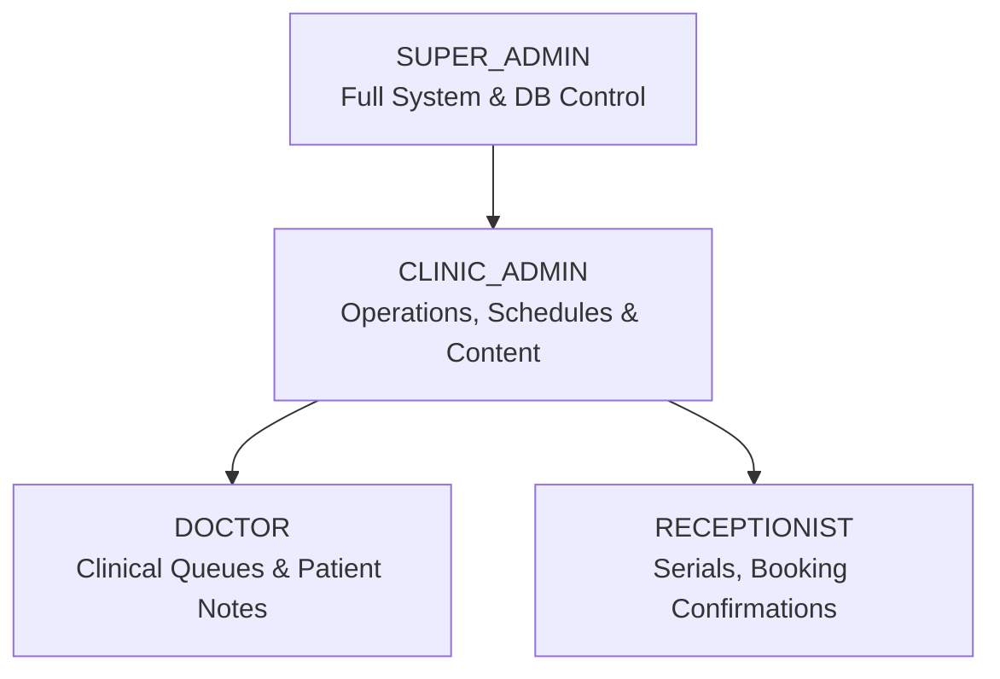
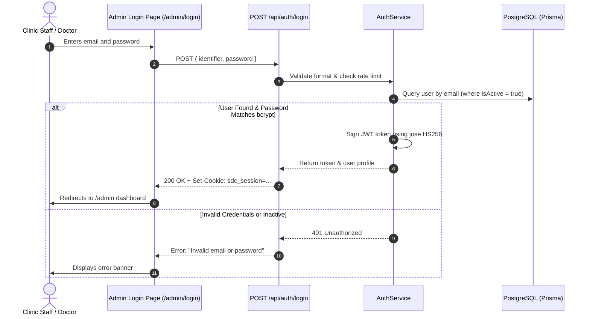

# Authentication, Authorization & Security Architecture
## Sakib Dental Care — Access Control & Session Security Specification

---

## 1. Authentication Philosophy & Objectives
The Sakib Dental Care system implements a **secure, zero-lockin, serverless-compatible authentication system** designed specifically for healthcare management. It utilizes **cryptographic JSON Web Tokens (JWTs)** managed via the edge-compatible `jose` library, stored exclusively in **HTTP-only, Secure, SameSite cookies**.

### Core Tenets:
1. **Zero External Dependency Downtime:** Authentication runs natively inside Next.js App Router route handlers without reliance on third-party SaaS identity providers.
2. **Defensive Edge Middleware:** Next.js Middleware guards all administrative routes (`/admin/*`) and API endpoints (`/api/admin/*`) at the network edge before hitting server components or handlers.
3. **Strict Healthcare Privacy:** Patient medical histories and internal doctor notes are restricted by role, preventing unauthorized access by front-desk or non-clinical personnel.

---

## 2. User Roles & Permission Matrix

The platform defines four distinct user roles within the `Role` enum:



### 2.1 Role Definitions
- **`SUPER_ADMIN`:** Technical administrator or clinic owner. Unrestricted access across database, user management, audit logs, and environment configurations.
- **`CLINIC_ADMIN`:** Practice manager. Controls branch schedules, holiday overrides, dental services catalog, pricing, website hero slides, FAQs, and staff accounts.
- **`DOCTOR` (Dr. Sakib):** Dental specialist. Reviews daily patient appointments, updates treatment progress (`IN_TREATMENT`, `COMPLETED`), and writes clinical notes.
- **`RECEPTIONIST`:** Front-desk officer. Confirms incoming appointments via WhatsApp/phone, manages daily serial queues, and creates walk-in records.

### 2.2 Granular Permission Matrix

| Capability / Module | SUPER_ADMIN | CLINIC_ADMIN | DOCTOR | RECEPTIONIST |
| :--- | :---: | :---: | :---: | :---: |
| **View Appointments List** | Full | Full | Full | Full |
| **Confirm / Re-schedule Serial** | Yes | Yes | Yes | Yes |
| **Create Walk-in / Phone Serial** | Yes | Yes | Yes | Yes |
| **Update Clinical & Doctor Notes** | Yes | Yes | Yes | Read Only |
| **Mark Treatment Completed** | Yes | Yes | Yes | No |
| **Delete / Archive Appointments** | Yes | Yes | No | No |
| **Export Patient Roster (CSV/Excel)** | Yes | Yes | Yes | Yes |
| **View Patient Medical History** | Yes | Yes | Yes | Basic Info Only |
| **Edit Branch Hours & Holidays** | Yes | Yes | No | No |
| **Manage Services & Pricing CMS** | Yes | Yes | Read Only | Read Only |
| **Manage Hero Slides & Media CMS** | Yes | Yes | No | No |
| **Manage FAQs & Clinic Settings** | Yes | Yes | No | No |
| **Create / Deactivate Staff Users** | Yes | Yes | No | No |
| **View Security Audit Logs** | Yes | Read Only | No | No |

---

## 3. Session Management & Cookie Architecture

### 3.1 Session Token Details
- **Cookie Name:** `sdc_session`
- **Algorithm:** `HS256` HMAC-SHA256 (signed using `JWT_SECRET`)
- **Duration:** 7 Days (604,800 seconds)
- **Cookie Flags:**
  - `HttpOnly = true`: Inaccessible to client-side JavaScript, fully protecting against XSS token theft.
  - `Secure = true`: Transmitted exclusively over encrypted HTTPS connections in production.
  - `SameSite = "lax"`: Prevents CSRF attacks while allowing top-level navigation.
  - `Path = "/"`: Accessible across public and admin subpaths.

### 3.2 JWT Payload Structure
```typescript
interface SessionPayload {
  sub: string;         // User UUID
  email: string;       // Staff email
  role: "SUPER_ADMIN" | "CLINIC_ADMIN" | "DOCTOR" | "RECEPTIONIST";
  fullName: string;    // Display name
  iat: number;         // Issued at timestamp (epoch seconds)
  exp: number;         // Expiration timestamp (epoch seconds)
}
```

---

## 4. Authentication Workflows

### 4.1 Login Sequence Diagram



---

## 5. Next.js Middleware Implementation Blueprint

The following security middleware intercepts requests at `src/middleware.ts`:

```typescript
import { NextResponse } from "next/server";
import type { NextRequest } from "next/server";
import { jwtVerify } from "jose";

const JWT_SECRET = new TextEncoder().encode(process.env.JWT_SECRET || "fallback-secret-for-dev-only");

export async function middleware(request: NextRequest) {
  const { pathname } = request.nextUrl;

  // 1. Determine if target route is protected
  const isAdminRoute = pathname.startsWith("/admin");
  const isAdminApiRoute = pathname.startsWith("/api/admin");
  const isLoginPage = pathname === "/admin/login";

  if (!isAdminRoute && !isAdminApiRoute) {
    return NextResponse.next();
  }

  // 2. Extract session cookie
  const sessionCookie = request.cookies.get("sdc_session")?.value;

  if (!sessionCookie) {
    if (isAdminApiRoute) {
      return NextResponse.json(
        { success: false, message: "Unauthorized. Please authenticate." },
        { status: 401 }
      );
    }
    if (isAdminRoute && !isLoginPage) {
      const loginUrl = new URL("/admin/login", request.url);
      loginUrl.searchParams.set("callbackUrl", pathname);
      return NextResponse.redirect(loginUrl);
    }
    return NextResponse.next();
  }

  // 3. Verify cryptographic signature & expiration
  try {
    const { payload } = await jwtVerify(sessionCookie, JWT_SECRET);
    
    // If logged-in user visits /admin/login, redirect to dashboard
    if (isLoginPage) {
      return NextResponse.redirect(new URL("/admin", request.url));
    }

    // Attach verified user data to request headers for downstream handlers
    const requestHeaders = new Headers(request.headers);
    requestHeaders.set("x-user-id", String(payload.sub));
    requestHeaders.set("x-user-role", String(payload.role));

    return NextResponse.next({
      request: {
        headers: requestHeaders,
      },
    });
  } catch (err) {
    // Token invalid or expired: clear cookie and redirect
    const response = isLoginPage
      ? NextResponse.next()
      : NextResponse.redirect(new URL("/admin/login", request.url));
    response.cookies.delete("sdc_session");
    return response;
  }
}

export const config = {
  matcher: ["/admin/:path*", "/api/admin/:path*"],
};
```

---

## 6. Password Security & Hashing Standards
- **Algorithm:** `bcryptjs`
- **Work Factor (Salt Rounds):** `12`
- **Password Complexity Policy:**
  - Minimum 8 characters.
  - Must include at least 1 uppercase letter, 1 lowercase letter, 1 digit, and 1 symbol.
- **Account Lockout:** Rate limits login attempts to **5 consecutive failures per 15 minutes** per IP/account to defeat credential stuffing and brute-force attacks.

---

## 7. Hidden Admin Access System (Desktop & Mobile Specification)

To preserve the client's minimalist portfolio presentation, the landing page completely omits public administrative buttons, dashboard navigation links, or login icons. Access is triggered discreetly via hardware/gesture detection.

### 7.1 Desktop Access: Keyboard ESC Detection
- **Trigger:** Pressing the `Escape` key (`event.key === "Escape"`) on the landing page.
- **Defensive Guards:**
  1. **Active Input Suppression:** ESC is ignored if `document.activeElement` or `event.target` is an `<input>`, `<textarea>`, `<select>`, or `contentEditable` element.
  2. **Dialog Conflict Prevention:** ESC is suppressed if another modal (e.g., `ServiceModal`, `PrintConfirmModal`), a mobile drawer, or an active combobox dropdown (`[aria-expanded="true"]`) is currently open.
  3. **Self-Dismissal:** If the admin modal is already open, pressing ESC immediately dismisses it, restoring background scrolling and returning focus to the trigger.

### 7.2 Mobile Access: Secret Multi-Tap Gesture Detection
- **Trigger Area:** The footer copyright notice (`<HiddenAdminTrigger as="p">{t("footerCopyright")}</HiddenAdminTrigger>`) and footer brand tooth emblem.
- **Sequence:** Requires **5 consecutive taps** within a configurable interval:
  - `maxIntervalMs = 800ms`: Each tap must occur within 800ms of the previous tap.
  - `timeoutMs = 2500ms`: The entire 5-tap sequence must finish within 2.5 seconds.
- **Automatic Sequence Reset:**
  - Any tap or pointer event outside the designated trigger area immediately resets the sequence count to 0.
  - Sequence resets if the timer between consecutive taps exceeds `maxIntervalMs`.
- **Mobile Browser Optimizations:**
  - `touch-action: manipulation;`: Eliminates iOS Safari and Android Chrome double-tap zoom delays.
  - `user-select: none;`: Prevents accidental blue/grey text highlight balloons during rapid tapping.
  - `-webkit-tap-highlight-color: transparent;`: Suppresses mobile browser tap flash highlights.
  - **Haptic Feedback:** On supported mobile devices, a subtle vibration pattern (`navigator.vibrate([30, 40, 30])`) signals successful activation.

### 7.3 Shared Authentication Modal Architecture
- Both triggers dispatch `sdc:open-admin-access` or invoke `<HiddenAdminAccess />` directly.
- Renders the shared `<AdminAuthForm />` in an accessible dark glassmorphism modal with:
  - Focus trap (`Tab` and `Shift+Tab` cycling)
  - `document.body` scroll-lock while open
  - Accessible ARIA dialog attributes (`role="dialog"`, `aria-modal="true"`)
  - Password peek visibility toggle
  - Top-right close button (✕), Cancel button, and backdrop click dismissal.
- Upon successful authentication with `/api/auth/login`, redirects directly to `/dashboard`.

> [!IMPORTANT]
> **Security Separation:** Hiding admin entry points is purely a UI/UX client requirement. All dashboard routes (`/admin/*`, `/dashboard/*`) and administrative APIs (`/api/admin/*`) remain strictly protected at the edge by `src/middleware.ts` through signed HTTP-only JWT verification (`sdc_admin_session`). Unauthenticated requests are rejected regardless of client UI state.


