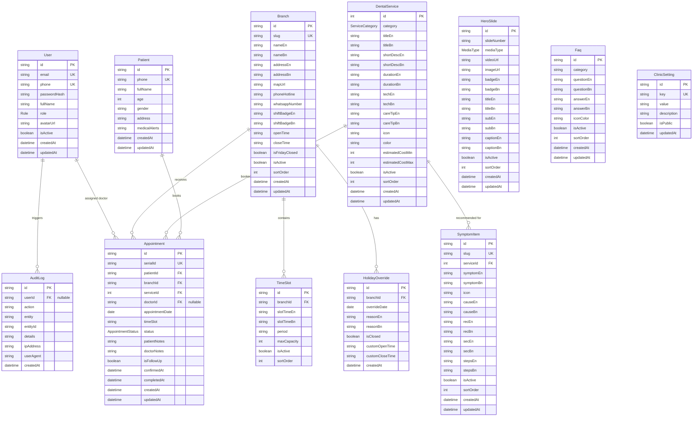

# Database Schema, Models & Data Flow Specification
## Sakib Dental Care — Relational Database Architecture

---

## 1. Overview & Technology Choice
The Sakib Dental Care system uses **PostgreSQL** as its core relational database engine, interfaced through **Prisma ORM**. PostgreSQL delivers ACID compliance, strict relational constraints, transactional isolation for appointment serial allocation, and fast indexed search across patient records and appointment schedules.

---

## 2. Entity-Relationship (ER) Diagram



---

## 3. Data Dictionary & Model Definitions

### 3.1 Authentication & User Management

#### `User` Model
Stores administrative, medical, and front-desk personnel.
- `id` (String / UUID, Primary Key): Unique internal user identifier.
- `email` (String, Unique): Administrator/staff login email.
- `phone` (String, Unique): Mobile phone number for 2FA or staff communications.
- `passwordHash` (String): Hashed password using `bcrypt` (work factor 12).
- `fullName` (String): Display name (e.g., "Dr. Sakib Dental Specialist").
- `role` (Enum `Role`): `SUPER_ADMIN`, `CLINIC_ADMIN`, `DOCTOR`, `RECEPTIONIST`.
- `avatarUrl` (String, Optional): Profile image URL.
- `isActive` (Boolean, Default: `true`): Deactivation flag for revoked staff.
- `createdAt` / `updatedAt` (DateTime): Timestamps.

#### `Role` Enum
- `SUPER_ADMIN`: Full system, database, and infrastructure control.
- `CLINIC_ADMIN`: Manages clinic schedules, services, users, content, and reports.
- `DOCTOR`: Access to patient appointments, queue status, and clinical notes.
- `RECEPTIONIST`: Manages appointment serials, confirmations, and patient check-ins.

---

### 3.2 Clinical Patient & Appointment System

#### `Patient` Model
Stores patient profiles deduplicated by mobile phone number.
- `id` (String / UUID, Primary Key): Unique patient identifier.
- `phone` (String, Unique, Indexed): Primary contact phone number (`01XXXXXXXXX`).
- `fullName` (String): Patient's full name.
- `age` (Int, Optional): Patient's age in years.
- `gender` (String, Optional): `MALE`, `FEMALE`, `OTHER`.
- `address` (String, Optional): Resident locality (e.g., "Nowhata Bazar, Rajshahi").
- `medicalAlerts` (String, Optional): Known allergies, heart condition, diabetic note.
- `createdAt` / `updatedAt` (DateTime): Record timestamps.

#### `Appointment` Model
Stores scheduled clinic visits with unique serial codes and status states.
- `id` (String / UUID, Primary Key): Unique appointment record ID.
- `serialId` (String, Unique, Indexed): Human-readable clinical serial token (e.g., `SDC-20261030-001`).
- `patientId` (String, Foreign Key -> `Patient.id`): Associated patient.
- `branchId` (String, Foreign Key -> `Branch.id`): Selected clinic branch.
- `serviceId` (Int, Foreign Key -> `DentalService.id`): Requested primary treatment.
- `doctorId` (String, Optional, Foreign Key -> `User.id`): Assigned dentist.
- `appointmentDate` (DateTime, Indexed): Date of visit (stored at UTC midnight).
- `timeSlot` (String): Selected time slot (e.g., `10:30 AM (Morning)`).
- `status` (Enum `AppointmentStatus`): Default `PENDING`.
- `patientNotes` (String, Optional): Patient-provided symptoms or concerns.
- `doctorNotes` (String, Optional): Clinical diagnosis, treatment summary, or prescription notes.
- `isFollowUp` (Boolean, Default: `false`): Flag for multi-visit procedures (e.g., RCT Stage 2, Braces adjustment).
- `confirmedAt` (DateTime, Optional): Timestamp when front desk confirmed the visit.
- `completedAt` (DateTime, Optional): Timestamp when treatment was completed.
- `createdAt` / `updatedAt` (DateTime): Audit timestamps.

#### `AppointmentStatus` Enum
- `PENDING`: Initial submission via public web portal.
- `CONFIRMED`: Receptionist verified via WhatsApp or phone call.
- `IN_TREATMENT`: Patient arrived at chamber and is inside dental operatory.
- `COMPLETED`: Procedure finished and fees settled.
- `CANCELLED`: Patient or clinic cancelled the booking.
- `NO_SHOW`: Patient failed to appear during the allocated slot.

---

### 3.3 Multi-Branch & Dynamic Scheduling System

#### `Branch` Model
Represents physical clinic chambers.
- `id` (String / UUID, Primary Key): Unique branch ID.
- `slug` (String, Unique): URL/Key identifier (`nawhata`, `city`).
- `nameEn` / `nameBn` (String): Bilingual branch name.
- `addressEn` / `addressBn` (String): Detailed physical address.
- `mapUrl` (String): Google Maps pin/embed link.
- `phoneHotline` (String): Calling number (`01688-434676`).
- `whatsappNumber` (String): WhatsApp serial number (`01733-054717`).
- `shiftBadgeEn` / `shiftBadgeBn` (String): Shift labels (e.g., "Day Shift (9:00 AM - 6:00 PM)").
- `openTime` (String): 24-hr format string (e.g., `09:00`).
- `closeTime` (String): 24-hr format string (e.g., `18:00`).
- `isFridayClosed` (Boolean, Default: `false`): Friday holiday enforcement (`true` for Nowhata).
- `isActive` (Boolean, Default: `true`): Branch active visibility toggle.
- `sortOrder` (Int, Default: `0`): UI display ordering.

#### `TimeSlot` Model
Configurable bookable time periods per branch.
- `id` (String / UUID, Primary Key).
- `branchId` (String, Foreign Key -> `Branch.id`).
- `slotTimeEn` / `slotTimeBn` (String): E.g., `9:30 AM (Morning)` / `সকাল ৯:৩০ টা`.
- `period` (String): `MORNING`, `AFTERNOON`, `EVENING`, `NIGHT`.
- `maxCapacity` (Int, Default: `1`): Maximum allowable concurrent appointments per slot.
- `isActive` (Boolean, Default: `true`).
- `sortOrder` (Int, Default: `0`).

#### `HolidayOverride` Model
Special calendar exceptions, holidays, and emergency closures.
- `id` (String / UUID, Primary Key).
- `branchId` (String, Foreign Key -> `Branch.id`).
- `overrideDate` (DateTime, Indexed): Specific calendar date.
- `reasonEn` / `reasonBn` (String): E.g., "Eid-ul-Fitr Holiday" / "ঈদুল ফিতর উপলক্ষ্যে বন্ধ".
- `isClosed` (Boolean, Default: `true`): Full-day closure flag.
- `customOpenTime` / `customCloseTime` (String, Optional): Altered hours (e.g., for Ramadan shifts).

---

### 3.4 Content Management Models (CMS)

#### `DentalService` Model
Stores the 10+ core dental treatments and procedures.
- `id` (Int, Primary Key): Explicit integer IDs matching current frontend bindings (1 to 10).
- `category` (Enum `ServiceCategory`): `DIAGNOSTIC`, `RESTORATIVE`, `COSMETIC`, `ORTHO_SURGICAL`.
- `titleEn` / `titleBn` (String): Bilingual service titles.
- `shortDescEn` / `shortDescBn` (String): Bilingual treatment summaries.
- `durationEn` / `durationBn` (String): E.g., `45 – 60 Mins` / `৪৫ – ৬০ মিনিট`.
- `techEn` / `techBn` (String): Equipment tag (e.g., `Rotary Endomotor & Apex Locator`).
- `careTipEn` / `careTipBn` (String): Clinical post-treatment advice.
- `icon` (String): Phosphor icon class (e.g., `ph-tooth`, `ph-sparkle`).
- `color` (String): Color theme (`sky`, `indigo`, `teal`, `rose`, `amber`, `emerald`).
- `estimatedCostMin` / `estimatedCostMax` (Int, Optional): Fee ranges for patient transparency.
- `isActive` (Boolean, Default: `true`).
- `sortOrder` (Int, Default: `0`).

#### `SymptomItem` Model
Powers the interactive symptom-to-treatment finder.
- `id` (String, Primary Key): Identifier (`pain`, `bleeding`, `broken`, `crooked`, `child`, `xray-need`).
- `serviceId` (Int, Foreign Key -> `DentalService.id`): Primary recommended treatment.
- `symptomEn` / `symptomBn` (String): Clinical complaint title.
- `icon` (String): Phosphor icon.
- `causeEn` / `causeBn` (String): Explanation of underlying pathology.
- `recEn` / `recBn` (String): Primary recommendation title.
- `secEn` / `secBn` (String): Secondary diagnostic recommendation.
- `stepsEn` / `stepsBn` (String): JSON Array string storing step-by-step clinical process.
- `isActive` (Boolean, Default: `true`).
- `sortOrder` (Int, Default: `0`).

#### `HeroSlide` Model
Powers the main landing page video/image slider.
- `id` (String / UUID, Primary Key).
- `slideNumber` (String): Display badge (`01`, `02`, etc.).
- `mediaType` (Enum `MediaType`): `VIDEO` or `IMAGE`.
- `videoUrl` (String, Optional): MP4 stream URL.
- `imageUrl` (String): High-resolution poster image URL.
- `badgeEn` / `badgeBn` (String): Header pill badge.
- `titleEn` / `titleBn` (String): Slide headline.
- `subEn` / `subBn` (String): Slide subtitle description.
- `captionEn` / `captionBn` (String): Bottom slide caption text.
- `isActive` (Boolean, Default: `true`).
- `sortOrder` (Int, Default: `0`).

#### `Faq` Model
- `id` (String / UUID, Primary Key).
- `category` (String, Default: `GENERAL`).
- `questionEn` / `questionBn` (String): FAQ title.
- `answerEn` / `answerBn` (String): Rich HTML / Markdown answer.
- `iconColor` (String): Tailwind color class (`text-sky-500`, etc.).
- `isActive` (Boolean, Default: `true`).
- `sortOrder` (Int, Default: `0`).

#### `ClinicSetting` Model
Key-value store for global runtime clinic parameters.
- `id` (String / UUID, Primary Key).
- `key` (String, Unique): E.g., `PRIMARY_HOTLINE`, `WHATSAPP_SERIAL`, `EMERGENCY_BANNER_TEXT`, `NOTICE_ACTIVE`.
- `value` (String): Value or JSON configuration string.
- `description` (String): Setting explanation for admins.
- `isPublic` (Boolean, Default: `true`): Expose to public web portal without authentication.

#### `AuditLog` Model
Immutable compliance trail for administrative actions.
- `id` (String / UUID, Primary Key).
- `userId` (String, Optional, Foreign Key -> `User.id`).
- `action` (String): `CREATE_APPOINTMENT`, `CONFIRM_APPOINTMENT`, `UPDATE_SERVICE`, `LOGIN_SUCCESS`, etc.
- `entity` (String): Table name (`Appointment`, `DentalService`, `Branch`).
- `entityId` (String): ID of mutated record.
- `details` (String): JSON diff of before/after changes.
- `ipAddress` (String): Client IP.
- `userAgent` (String): Client browser string.
- `createdAt` (DateTime, Default: `now()`).

---

## 4. Complete Prisma Schema (`prisma/schema.prisma`)

```prisma
datasource db {
  provider = "postgresql"
  url      = env("DATABASE_URL")
}

generator client {
  provider = "prisma-client-js"
}

enum Role {
  SUPER_ADMIN
  CLINIC_ADMIN
  DOCTOR
  RECEPTIONIST
}

enum AppointmentStatus {
  PENDING
  CONFIRMED
  IN_TREATMENT
  COMPLETED
  CANCELLED
  NO_SHOW
}

enum ServiceCategory {
  DIAGNOSTIC
  RESTORATIVE
  COSMETIC
  ORTHO_SURGICAL
}

enum MediaType {
  VIDEO
  IMAGE
}

model User {
  id           String        @id @default(uuid())
  email        String        @unique
  phone        String?       @unique
  passwordHash String
  fullName     String
  role         Role          @default(RECEPTIONIST)
  avatarUrl    String?
  isActive     Boolean       @default(true)
  createdAt    DateTime      @default(now())
  updatedAt    DateTime      @updatedAt

  appointments Appointment[] @relation("DoctorAppointments")
  auditLogs    AuditLog[]

  @@index([email])
  @@index([role])
}

model Patient {
  id            String        @id @default(uuid())
  phone         String        @unique
  fullName      String
  age           Int?
  gender        String?
  address       String?
  medicalAlerts String?
  createdAt     DateTime      @default(now())
  updatedAt     DateTime      @updatedAt

  appointments  Appointment[]

  @@index([phone])
}

model Branch {
  id             String            @id @default(uuid())
  slug           String            @unique
  nameEn         String
  nameBn         String
  addressEn      String
  addressBn      String
  mapUrl         String?
  phoneHotline   String
  whatsappNumber String
  shiftBadgeEn   String
  shiftBadgeBn   String
  openTime       String            // "09:00"
  closeTime      String            // "18:00"
  isFridayClosed Boolean           @default(false)
  isActive       Boolean           @default(true)
  sortOrder      Int               @default(0)
  createdAt      DateTime          @default(now())
  updatedAt      DateTime          @updatedAt

  timeSlots      TimeSlot[]
  overrides      HolidayOverride[]
  appointments   Appointment[]

  @@index([slug])
  @@index([isActive])
}

model TimeSlot {
  id          String   @id @default(uuid())
  branchId    String
  branch      Branch   @relation(fields: [branchId], references: [id], onDelete: Cascade)
  slotTimeEn  String
  slotTimeBn  String
  period      String   @default("MORNING") // MORNING, AFTERNOON, EVENING, NIGHT
  maxCapacity Int      @default(1)
  isActive    Boolean  @default(true)
  sortOrder   Int      @default(0)

  @@index([branchId, isActive])
}

model HolidayOverride {
  id              String   @id @default(uuid())
  branchId        String
  branch          Branch   @relation(fields: [branchId], references: [id], onDelete: Cascade)
  overrideDate    DateTime @db.Date
  reasonEn        String
  reasonBn        String
  isClosed        Boolean  @default(true)
  customOpenTime  String?
  customCloseTime String?
  createdAt       DateTime @default(now())

  @@unique([branchId, overrideDate])
  @@index([overrideDate])
}

model DentalService {
  id               Int             @id
  category         ServiceCategory
  titleEn          String
  titleBn          String
  shortDescEn      String
  shortDescBn      String
  durationEn       String
  durationBn       String
  techEn           String
  techBn           String
  careTipEn        String
  careTipBn        String
  icon             String          @default("ph-tooth")
  color            String          @default("sky")
  estimatedCostMin Int?
  estimatedCostMax Int?
  isActive         Boolean         @default(true)
  sortOrder        Int             @default(0)
  createdAt        DateTime        @default(now())
  updatedAt        DateTime        @updatedAt

  appointments     Appointment[]
  symptoms         SymptomItem[]

  @@index([category, isActive])
  @@index([sortOrder])
}

model SymptomItem {
  id        String        @id
  slug      String        @unique
  serviceId Int
  service   DentalService @relation(fields: [serviceId], references: [id])
  symptomEn String
  symptomBn String
  icon      String
  causeEn   String
  causeBn   String
  recEn     String
  recBn     String
  secEn     String
  secBn     String
  stepsEn   String        // JSON stringified array of steps
  stepsBn   String        // JSON stringified array of steps
  isActive  Boolean       @default(true)
  sortOrder Int           @default(0)
  createdAt DateTime      @default(now())
  updatedAt DateTime      @updatedAt

  @@index([slug])
  @@index([serviceId])
}

model Appointment {
  id              String            @id @default(uuid())
  serialId        String            @unique // E.g., "SDC-20261030-001"
  patientId       String
  patient         Patient           @relation(fields: [patientId], references: [id])
  branchId        String
  branch          Branch            @relation(fields: [branchId], references: [id])
  serviceId       Int
  service         DentalService     @relation(fields: [serviceId], references: [id])
  doctorId        String?
  doctor          User?             @relation("DoctorAppointments", fields: [doctorId], references: [id])
  appointmentDate DateTime          @db.Date
  timeSlot        String
  status          AppointmentStatus @default(PENDING)
  patientNotes    String?
  doctorNotes     String?
  isFollowUp      Boolean           @default(false)
  confirmedAt     DateTime?
  completedAt     DateTime?
  createdAt       DateTime          @default(now())
  updatedAt       DateTime          @updatedAt

  @@index([appointmentDate, branchId])
  @@index([status])
  @@index([serialId])
  @@index([patientId])
}

model HeroSlide {
  id          String    @id @default(uuid())
  slideNumber String    // "01", "02"
  mediaType   MediaType @default(IMAGE)
  videoUrl    String?
  imageUrl    String
  badgeEn     String
  badgeBn     String
  titleEn     String
  titleBn     String
  subEn       String
  subBn       String
  captionEn   String
  captionBn   String
  isActive    Boolean   @default(true)
  sortOrder   Int       @default(0)
  createdAt   DateTime  @default(now())
  updatedAt   DateTime  @updatedAt

  @@index([isActive, sortOrder])
}

model Faq {
  id         String   @id @default(uuid())
  category   String   @default("GENERAL")
  questionEn String
  questionBn String
  answerEn   String
  answerBn   String
  iconColor  String   @default("text-sky-500")
  isActive   Boolean  @default(true)
  sortOrder  Int      @default(0)
  createdAt  DateTime @default(now())
  updatedAt  DateTime @updatedAt

  @@index([isActive, sortOrder])
}

model ClinicSetting {
  id          String   @id @default(uuid())
  key         String   @unique
  value       String   @db.Text
  description String?
  isPublic    Boolean  @default(true)
  updatedAt   DateTime @updatedAt

  @@index([key])
}

model AuditLog {
  id        String   @id @default(uuid())
  userId    String?
  user      User?    @relation(fields: [userId], references: [id], onDelete: SetNull)
  action    String
  entity    String
  entityId  String
  details   String?  @db.Text
  ipAddress String?
  userAgent String?
  createdAt DateTime @default(now())

  @@index([userId])
  @@index([entity, entityId])
  @@index([createdAt])
}
```

---

## 5. Serial Generation Algorithm

To guarantee deterministic, non-colliding serial numbers that patients and receptionists can quote over the phone or WhatsApp, the backend implements the following atomic sequence generation within a PostgreSQL transaction:

```typescript
// Algorithm: SDC-YYYYMMDD-XXX (e.g. SDC-20261030-001)
const dateStr = format(appointmentDate, 'yyyyMMdd');
const prefix = `SDC-${dateStr}-`;

const todayCount = await tx.appointment.count({
  where: {
    appointmentDate: {
      gte: startOfDay(appointmentDate),
      lte: endOfDay(appointmentDate)
    }
  }
});

const nextSequence = String(todayCount + 1).padStart(3, '0');
const serialId = `${prefix}${nextSequence}`;
```

This ensures predictable daily serial sequences (001, 002, 003...) aligned with clinic operation counters.

