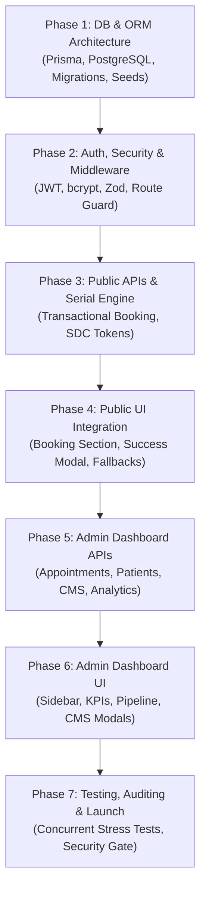

# Step-by-Step Backend Development Roadmap & Implementation Plan
## Sakib Dental Care — Unified Full-Stack Platform

---

## 1. Roadmap Overview & Milestones

This document provides an actionable, phase-by-phase implementation blueprint for building the complete backend and centralized Admin Dashboard using Next.js 15 App Router route handlers.

---

## 2. Phase 1: Database Foundation & ORM Setup
**Objective:** Establish PostgreSQL relational schema, generate Prisma client, and seed initial clinic data.

### Tasks:
1. **Dependency Installation:**
   - Install `@prisma/client` and `prisma` as dev dependency.
2. **Prisma Schema Implementation:**
   - Create `prisma/schema.prisma` with models: `User`, `Patient`, `Appointment`, `Branch`, `TimeSlot`, `HolidayOverride`, `DentalService`, `SymptomItem`, `HeroSlide`, `Faq`, `ClinicSetting`, `AuditLog`.
3. **Database Migration:**
   - Execute initial migration: `npx prisma migrate dev --name init_sakib_dental_schema`.
4. **Data Seeding Script (`prisma/seed.ts`):**
   - Extract and migrate hardcoded data from `src/data/services.ts`, `src/data/branches.ts`, `src/data/heroSlides.ts`, `src/data/symptoms.ts`, and `src/data/translations.ts`.
   - Seed default `SUPER_ADMIN` user (`admin@sakibdental.com`) with securely hashed password.
   - Configure `"prisma": { "seed": "ts-node --compiler-options {\"module\":\"CommonJS\"} prisma/seed.ts" }` in `package.json`.

---

## 3. Phase 2: Security, Validation & Authentication Layer
**Objective:** Build edge-ready session authentication, Zod validation schemas, and role-based access control.

### Tasks:
1. **Install Core Utilities:**
   - `npm install zod jose bcryptjs date-fns date-fns-tz`
   - `npm install -D @types/bcryptjs`
2. **Validation Schemas (`src/lib/validations/`):**
   - Create `appointment.schema.ts` (strict Bangladeshi phone regex, date validation).
   - Create `auth.schema.ts` (email/phone and password schema).
   - Create `service.schema.ts`, `branch.schema.ts`, `cms.schema.ts`.
3. **Authentication & Session Utilities (`src/lib/auth/`):**
   - `session.ts`: Mint and verify JWT tokens via `jose` using `HS256`.
   - `password.ts`: Hash passwords with `bcryptjs` (salt rounds 12) and compare hashes.
   - `rbac.ts`: Enforce role capabilities (`SUPER_ADMIN`, `CLINIC_ADMIN`, `DOCTOR`, `RECEPTIONIST`).
4. **Next.js Edge Middleware (`src/middleware.ts`):**
   - Guard `/admin/*` and `/api/admin/*` routes.
   - Verify `sdc_session` cookie; redirect unauthorized requests to `/admin/login`.
   - Inject HTTP security headers (HSTS, CSP, X-Frame-Options).
5. **Auth Route Handlers (`src/app/api/auth/`):**
   - `POST /api/auth/login`: Issue HTTP-only secure cookie upon verified credentials.
   - `POST /api/auth/logout`: Expire cookie and end session.
   - `GET /api/auth/me`: Return current user profile and role permissions.

---

## 4. Phase 3: Public APIs & Transactional Serial Generation
**Objective:** Deliver high-speed cached content APIs and atomic appointment serial booking.

### Tasks:
1. **Content Route Handlers (`src/app/api/public/`):**
   - `GET /api/public/branches`: Dynamic branches and active slots (tag: `branches`).
   - `GET /api/public/services`: Filterable 10+ dental services (tag: `services`).
   - `GET /api/public/symptoms`: Triage guide entries (tag: `symptoms`).
   - `GET /api/public/hero-slides`: Landing page carousel (tag: `hero-slides`).
   - `GET /api/public/faqs`: FAQs (tag: `faqs`).
   - `GET /api/public/settings`: Public clinic hotlines and emergency banners (tag: `settings`).
2. **Appointment Booking Engine (`src/app/api/appointments/route.ts`):**
   - Validate payload via Zod.
   - Execute inside Prisma `$transaction`:
     - Deduplicate or create `Patient` by phone.
     - Verify slot capacity and branch holiday status.
     - Generate deterministic serial ID: `SDC-YYYYMMDD-XXX`.
     - Insert `Appointment` with status `PENDING`.
   - Return 201 Created with appointment pass DTO and pre-compiled WhatsApp deep-link URL.
3. **Appointment Tracking Route (`src/app/api/appointments/track/route.ts`):**
   - Enable patients to check serial status by entering their serial ID and phone.

---

## 5. Phase 4: Public Frontend Integration
**Objective:** Connect public landing page components to backend APIs without altering the existing visual design.

### Tasks:
1. **Booking Section Enhancement (`src/components/sections/BookingSection.tsx`):**
   - Replace client-only WhatsApp redirection with asynchronous API call to `POST /api/appointments`.
   - On successful response, display rich confirmation dialog (`BookingSuccessModal.tsx`).
   - Maintain instant WhatsApp launch button (`wa.me`) using the verified serial code.
2. **Add Digital Serial Pass Modal (`src/components/modals/BookingSuccessModal.tsx`):**
   - Displays official serial token, patient name, branch, appointment date, and time slot.
   - Actions: "Open WhatsApp Confirmation" and "Copy Digital Serial Slip".
3. **Resilience & Fallback Mechanism:**
   - If the database is temporarily unreachable, components gracefully fall back to local `src/data/*.ts` assets, guaranteeing 100% public uptime.

---

## 6. Phase 5: Centralized Admin Dashboard Backend APIs
**Objective:** Build full CRUD route handlers for all administrative modules under `/api/admin/`.

### Tasks:
1. **Appointment APIs (`/api/admin/appointments`):**
   - `GET`: Paginated appointments with date, branch, and status filters.
   - `PATCH /[id]`: Update status (`CONFIRMED`, `IN_TREATMENT`, `COMPLETED`, `CANCELLED`), doctor notes, time slot.
   - `POST`: Create offline walk-in serials directly.
   - `GET /export`: Generate CSV export of daily appointment rosters.
2. **Patient Directory APIs (`/api/admin/patients`):**
   - Search patients, fetch clinical history, and edit medical alerts.
3. **Branch & Schedule APIs (`/api/admin/branches`):**
   - Modify branch timings, manage time slots, and configure holiday overrides.
4. **Content Management APIs (CMS):**
   - CRUD for Services, Hero Slides, Symptoms, FAQs, and Clinic Settings.
   - Call `revalidateTag()` on every mutation to purge public caches instantly.
5. **Analytics & Reports (`/api/admin/analytics/overview`):**
   - Aggregated metrics: daily volume, branch queue counts, completion rates, top requested treatments.
6. **User Management & Audit Logs (`/api/admin/users`, `/api/admin/audit-logs`):**
   - Staff account provisioning and immutable audit trails.

---

## 7. Phase 6: Centralized Admin Dashboard User Interface
**Objective:** Construct a responsive, modern admin portal under `src/app/(admin)/admin/`.

### Tasks:
1. **Admin Layout & Navigation Shell (`src/app/(admin)/admin/layout.tsx`):**
   - Responsive collapsible sidebar matching Apple glass aesthetic.
   - Top navigation bar featuring live branch status clock, quick search, and user profile dropdown.
2. **Staff Login Interface (`src/app/(admin)/admin/login/page.tsx`):**
   - Elegant, secure glassmorphism login form with loading indicators and error states.
3. **Executive Dashboard (`src/app/(admin)/admin/page.tsx`):**
   - Real-time KPI stat cards: Today's Serials, Nowhata Queue, City Queue, Pending Serials.
   - Interactive appointment queue pipeline and weekly booking trend chart.
4. **Appointment Management Workspace (`src/app/(admin)/admin/appointments/page.tsx`):**
   - Data table and Kanban pipeline view with status badges.
   - Quick WhatsApp ping trigger, inline status updater, and walk-in creation modal.
   - Slide-over drawer for patient details and doctor clinical notes.
5. **Patient Directory (`src/app/(admin)/admin/patients/page.tsx`):**
   - Searchable patient roster and patient timeline view.
6. **Branch & Holiday Schedule Manager (`src/app/(admin)/admin/branches/page.tsx`):**
   - Interactive calendar to set holiday closures, Ramadan timings, and custom time slots.
7. **Services & Treatments CMS (`src/app/(admin)/admin/services/page.tsx`):**
   - Form modal with bilingual inputs, Phosphor icon selector, category filter, and pricing controls.
8. **Hero Slides & FAQ CMS (`src/app/(admin)/admin/hero-slides/`, `/faqs/`):**
   - Visual slide manager with video/image preview, badge editor, and reordering.
9. **Global Settings & Emergency Ticker (`src/app/(admin)/admin/settings/page.tsx`):**
   - Switch emergency notice banner on/off, edit text in English/Bengali, and manage clinic hotlines.

---

## 8. Phase 7: Verification, Security Audit & Production Launch
**Objective:** Rigorous end-to-end testing, security penetration checks, and deployment.

### Tasks:
1. **Concurrent Booking Stress Test:**
   - Simulate simultaneous submissions for the same time slot to verify transactional isolation.
2. **Security & RBAC Audit:**
   - Verify that unauthenticated requests to `/admin/*` redirect cleanly.
   - Confirm that `RECEPTIONIST` accounts cannot delete appointments or edit services.
   - Verify that patient medical notes are redacted from non-medical roles.
3. **Cross-Device & Cross-Browser Verification:**
   - Test dashboard responsiveness on iPhone, iPad, Android, and widescreen desktops.
4. **Production Deployment:**
   - Run Prisma production migrations (`npx prisma migrate deploy`).
   - Run seed script (`npx prisma db seed`).
   - Deploy to Vercel/Node host with environment variables configured.

